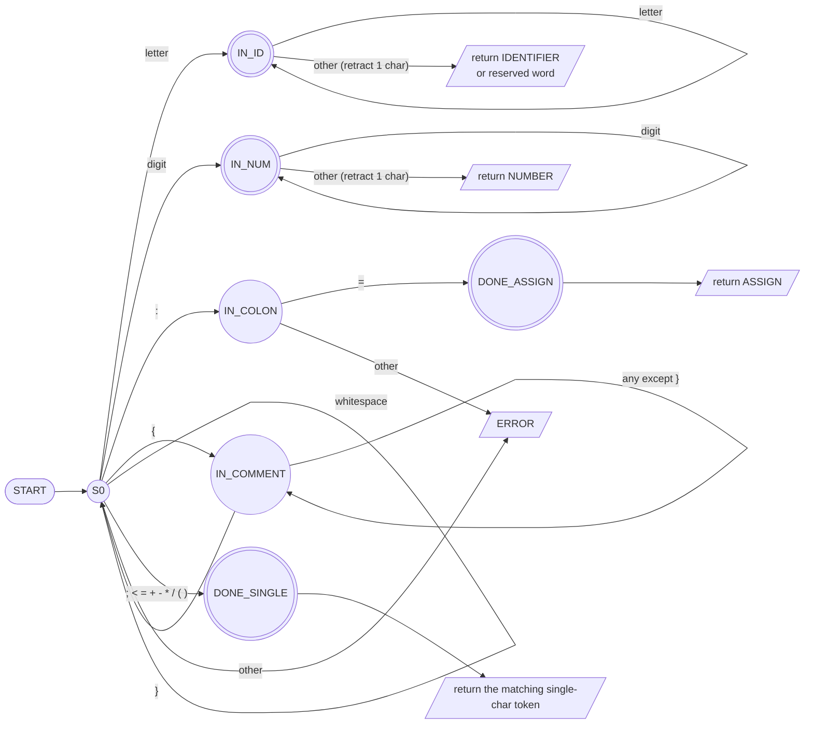

# TINY Language Scanner: DFA and Token List

## 1. Token list: (token value, token type)

| Token value / example | Token type |
|---|---|
| `;` | SEMICOLON |
| `if` | IF |
| `then` | THEN |
| `else` | ELSE (appears in the grammar, but not in the token table of the handout) |
| `end` | END |
| `repeat` | REPEAT |
| `until` | UNTIL |
| `read` | READ |
| `write` | WRITE |
| `x`, `abc`, `xyz` | IDENTIFIER |
| `:=` | ASSIGN |
| `<` | LESSTHAN |
| `=` | EQUAL |
| `+` | PLUS |
| `-` | MINUS |
| `*` | MULT |
| `/` | DIV |
| `(` | OPENBRACKET |
| `)` | CLOSEDBRACKET |
| `12`, `289` | NUMBER |

Reserved words (`if`, `then`, `else`, `end`, `repeat`, `until`, `read`, `write`) are matched by the IDENTIFIER path of the DFA. After the DFA accepts, the lexeme is looked up in a reserved-word table. If it is found, the reserved token type is returned. Otherwise the type is IDENTIFIER.

## 2. Regular definitions

```
letter     = [a-zA-Z]
digit      = [0-9]
IDENTIFIER = letter+
NUMBER     = digit+
ASSIGN     = ":="
comment    = "{" [^}]* "}"      (skipped, no token)
whitespace = (space | tab | newline)+   (skipped, no token)
```

## 3. DFA (focus: IDENTIFIER, ASSIGN, NUMBER)



Notes:
- Triple circles `(((...)))` are accepting states.
- "retract 1 char" means the character that ended the token (the `other` transition) is pushed back so it is read again from S0.
- `:` alone is not a valid token in TINY. It is only valid as the start of `:=`.

## 4. Transition table

| State | letter | digit | `:` | `=` | `{` | `}` | whitespace | `; < + - * / ( )` | other |
|---|---|---|---|---|---|---|---|---|---|
| **S0** (start) | IN_ID | IN_NUM | IN_COLON | DONE_SINGLE (EQUAL) | IN_COMMENT | ERROR | S0 | DONE_SINGLE | ERROR |
| **IN_ID** | IN_ID | DONE_ID* | DONE_ID* | DONE_ID* | DONE_ID* | DONE_ID* | DONE_ID* | DONE_ID* | DONE_ID* |
| **IN_NUM** | DONE_NUM* | IN_NUM | DONE_NUM* | DONE_NUM* | DONE_NUM* | DONE_NUM* | DONE_NUM* | DONE_NUM* | DONE_NUM* |
| **IN_COLON** | ERROR | ERROR | ERROR | **DONE_ASSIGN** | ERROR | ERROR | ERROR | ERROR | ERROR |
| **IN_COMMENT** | IN_COMMENT | IN_COMMENT | IN_COMMENT | IN_COMMENT | IN_COMMENT | S0 | IN_COMMENT | IN_COMMENT | IN_COMMENT |

`*` = accepting state reached with retraction (the last character is not part of the token).

Accepting states: IN_ID (IDENTIFIER / reserved word), IN_NUM (NUMBER), DONE_ASSIGN (ASSIGN), DONE_SINGLE (SEMICOLON, LESSTHAN, EQUAL, PLUS, MINUS, MULT, DIV, OPENBRACKET, CLOSEDBRACKET).

## 5. Example: scanning `x := 12;`

| Step | Characters read | Path through DFA | Output (value, type) |
|---|---|---|---|
| 1 | `x` then space | S0 → IN_ID → accept (retract space) | (`x`, IDENTIFIER) |
| 2 | space | S0 → S0 (skipped) | none |
| 3 | `:=` | S0 → IN_COLON → DONE_ASSIGN | (`:=`, ASSIGN) |
| 4 | space | S0 → S0 (skipped) | none |
| 5 | `12` then `;` | S0 → IN_NUM → IN_NUM → accept (retract `;`) | (`12`, NUMBER) |
| 6 | `;` | S0 → DONE_SINGLE | (`;`, SEMICOLON) |

## 6. Example: scanning part of the sample program

Input: `read x; if 0 < x then fact := 1;`

```
(read,  READ)
(x,     IDENTIFIER)
(;,     SEMICOLON)
(if,    IF)
(0,     NUMBER)
(<,     LESSTHAN)
(x,     IDENTIFIER)
(then,  THEN)
(fact,  IDENTIFIER)
(:=,    ASSIGN)
(1,     NUMBER)
(;,     SEMICOLON)
```
