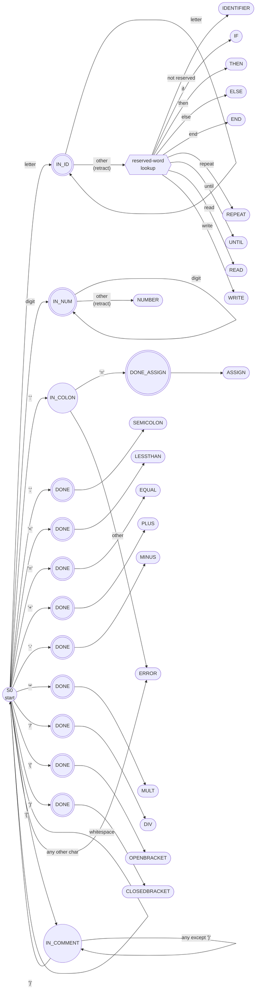

# TINY Scanner DFA: All Tokens

Every token type has its own accepting state. Triple circles `(((...)))` are accepting states. Rounded boxes show the token returned.

## 1. Full DFA

## 2. Summary: token, accepting state, lexeme

| Token type | Lexeme | Accepting state | Path from S0 |
|---|---|---|---|
| IDENTIFIER | `x`, `abc`, `xyz` | IN_ID | letter, then letter* |
| IF | `if` | IN_ID + lookup | letters spelling `if` |
| THEN | `then` | IN_ID + lookup | letters spelling `then` |
| ELSE | `else` | IN_ID + lookup | letters spelling `else` |
| END | `end` | IN_ID + lookup | letters spelling `end` |
| REPEAT | `repeat` | IN_ID + lookup | letters spelling `repeat` |
| UNTIL | `until` | IN_ID + lookup | letters spelling `until` |
| READ | `read` | IN_ID + lookup | letters spelling `read` |
| WRITE | `write` | IN_ID + lookup | letters spelling `write` |
| NUMBER | `12`, `289` | IN_NUM | digit, then digit* |
| ASSIGN | `:=` | DONE_ASSIGN | `:` then `=` |
| SEMICOLON | `;` | DONE | `;` |
| LESSTHAN | `<` | DONE | `<` |
| EQUAL | `=` | DONE | `=` |
| PLUS | `+` | DONE | `+` |
| MINUS | `-` | DONE | `-` |
| MULT | `*` | DONE | `*` |
| DIV | `/` | DONE | `/` |
| OPENBRACKET | `(` | DONE | `(` |
| CLOSEDBRACKET | `)` | DONE | `)` |

## 3. Notes

- **Reserved words:** keywords follow the same letter path as identifiers. Once the DFA accepts in IN_ID, the lexeme is compared with the 8 reserved words. This is the standard approach, and it keeps the DFA small. (The textbook TINY scanner does the same.)
- **Retraction:** IN_ID and IN_NUM end on a character that is not part of the token, so that character is pushed back and read again from S0.
- **Longest match:** `:=` is only recognised when `=` directly follows `:`. A lone `:` is an error. The single `=` in S0 gives EQUAL.
- **No token output:** whitespace and `{ ... }` comments return to S0 without producing a token.
- **ELSE** is included because the TINY grammar uses it, but it is not in the handout's token table.
